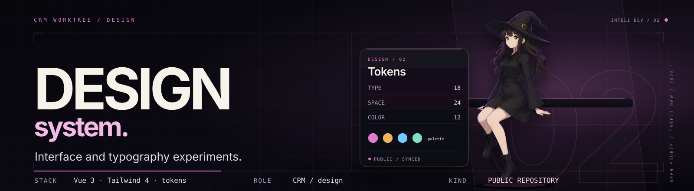

# inteli dev CRM

[English](README.md) · [Русский](README.ru.md) · [中文](README.zh_CN.md)



A workspace for the self-employed: clients, briefs, projects, tasks, invoices, reports, custom fields and the Kiki assistant — all in one place.

The CRM is closed: there is no registration, accounts are created by the owner. The administrator runs the practice, the client sees only their own tasks, invoices and reports.

## Features

- **Clients and tasks** — statuses, priorities, deadlines, checklists, comments and change history.
- **Projects** — keys like `KOR`, client, members with `manager`/`member`/`viewer` roles, progress, website, `AGENTS.md` and website exploration.
- **Briefs and request forms** — a client brief wizard, reusable templates, required fields, structured requests and export.
- **Task templates** — repeatable scenarios with required fields, checklists and AI-assisted drafts.
- **Invoices and payments** — YooKassa, direct transfers, recurring payments and reminders.
- **Client reports** — repeatable groups "explanation → link to check → screenshot", recipients, unread status and an optional task link.
- **Custom fields** — typed values for clients, projects and tasks; no loose JSON blobs.
- **Library** — materials and documents of the workspace.
- **Kiki** — an assistant with access to the CRM through tools: finds clients and tasks, reads briefs, prepares task plans, creates forms and helps with the interface.
- **Help** — a map of CRM sections with steps and links.
- **API and MCP** — REST API v1 and a 39-tool MCP server for external AI clients.
- **Legal pages** — privacy policy and consent to data processing.

## Stack

| Layer | Technologies |
|---|---|
| Backend | PHP 8.5, Laravel 13 |
| Frontend | Vue 3.5, Inertia 3, Vite 8, Tailwind CSS 4 |
| Database | PostgreSQL 16, Redis 7 |
| Quality | Pest 5, Pint |
| Infrastructure | Docker Compose, nginx, Traefik, Let's Encrypt |

## Quick start

Docker and Docker Compose are required.

```bash
git clone git@github.com:aigen31/inteli-dev-crm.git
cd inteli-dev-crm

cp .env.example .env
# Specify APP_KEY, DB_PASSWORD and other required values

docker compose build
docker compose up -d --wait
docker compose exec app php artisan migrate --force
docker compose exec app php artisan db:seed --force
```

The application will open at `http://localhost:${APP_PORT}`.
Healthcheck: `GET /up`.

Useful commands:

```bash
# Application logs
docker compose logs -f app

# Tests
docker compose exec app php artisan test

# Code style
docker compose exec app vendor/bin/pint --test

# Frontend build
npm run build
```

## Environment variables

The main parameters are in `.env`:

- `APP_URL`, `APP_KEY`, `APP_ENV` — basic application settings.
- `DB_*` — connection to PostgreSQL.
- `REDIS_*` — cache, sessions and queues.
- `KERNEL_URL`, `KERNEL_TOKEN`, `KERNEL_PROVIDER_TOKEN` — connection to the central Kiki kernel.
- `YOOKASSA_*` — payment acceptance.
- `MCP_TOKEN` — access to the MCP server.

Secrets are not committed. For production, use a separate `.env`/`.env.production`.

## Architecture

```text
app/
├── Actions/          # business operations: creation, status change, payment
├── Enums/            # roles, statuses, types and payment methods
├── Http/
│   ├── Controllers/  # Admin, Client, Api/V1, Internal, Mcp
│   ├── Middleware/   # authorization, API tokens, kernel contract
│   └── Requests/     # validation of incoming data
├── Models/           # Eloquent models
├── Services/         # domain services and AI integration
└── Policies/         # access to clients, tasks and projects

resources/js/
├── Pages/            # Inertia pages Admin/Client/Assistant
├── Components/       # UI, forms, assistant, Kiki
├── Composables/      # chat state and shared scenarios
└── css/              # design tokens and Tailwind

mcp/                  # MCP server
docs/agents/          # development documentation
docker/               # Dockerfile, nginx, entrypoint
```

Business logic lives in `Actions`/`Services`; controllers receive the request, authorize and delegate. Custom fields go through `CustomFieldService`; HTML from WYSIWYG and AI goes through `HtmlSanitizer`. Project access is checked by policy on every project-scoped task.

## Kiki and external integrations

Kiki works through the central kernel (`inteli-dev-kiki-assistant-kernel-api`). The CRM:

- provides the kernel with the system prompt, the tool list and page context;
- accepts tool calls through the internal contract `/api/internal/assistant`;
- stores a mirror of dialogues, attachments, documents and action confirmations;
- keeps Kiki's sessions read-only mirrors: titles, pins and archives belong to the kernel.

Kiki's financial actions run only after user confirmation; permissions are re-checked at the moment of confirmation. Task plans and forms also arrive as `AiAction` and need the same confirmation.

The REST API is available at `/api/v1`, MCP — at `/api/mcp`. More details: [docs/agents/api.md](docs/agents/api.md) and [docs/agents/mcp.md](docs/agents/mcp.md).

## Production

The production stack uses Traefik, the external network `traefik-public` and a separate nginx container.

```bash
# local production configuration without dev-override
docker compose -f docker-compose.yml up -d --wait

# migrations
docker compose -f docker-compose.yml exec app php artisan migrate --force
```

For remote deployment, `deploy.sh` synchronizes the project, builds images and checks `/up`. Configure SSH access and `.env.production` first.

### Repository and branches

| Branch / worktree | Purpose |
|---|---|
| `dev` | the only branch for new work; tests and smoke checks run here |
| `master` | release mirror, updated from `dev` with `--no-ff` after green tests |
| `production` | deploy branch, updated only by a merge from `master` |
| `inteli-dev-crm-design` | separate worktree on `design` for UI experiments and the design system |

Direct commits to `master` or `production` bypassing `dev` are not allowed.

## Documentation

| Topic | Document |
|---|---|
| Installation and environment | [docs/agents/setup.md](docs/agents/setup.md) |
| Architecture and domain | [docs/agents/architecture.md](docs/agents/architecture.md) |
| Projects and tasks | [docs/agents/project-management.md](docs/agents/project-management.md) |
| Client briefs | [docs/agents/briefs.md](docs/agents/briefs.md) |
| Request forms | [docs/agents/form-templates.md](docs/agents/form-templates.md) |
| Custom fields | [docs/agents/custom-fields.md](docs/agents/custom-fields.md) |
| Kiki and AI | [docs/agents/ai.md](docs/agents/ai.md) |
| REST API | [docs/agents/api.md](docs/agents/api.md) |
| MCP | [docs/agents/mcp.md](docs/agents/mcp.md) |
| Frontend and design | [docs/agents/frontend.md](docs/agents/frontend.md) |
| Design system | [docs/agents/design-system.md](docs/agents/design-system.md) |
| Kiki assets | [docs/agents/kiki-assets.md](docs/agents/kiki-assets.md) |
| Operational gotchas | [docs/agents/gotchas.md](docs/agents/gotchas.md) |
| Testing | [docs/agents/testing.md](docs/agents/testing.md) |
| Deployment | [docs/agents/deployment.md](docs/agents/deployment.md) |

## Testing

```bash
docker compose exec app php artisan test
docker compose exec app vendor/bin/pint --test
cd mcp && npm test
```

Tests use SQLite `:memory:` (see `phpunit.xml`) and do not touch the production database.

## Roles

- **Administrator** — manages clients, tasks, projects, invoices, templates, reports and access.
- **Client** — sees their own tasks, invoices, reports and projects, creates requests and communicates with Kiki.

---

Made at [inteli dev](https://inteli-dev.ru).
