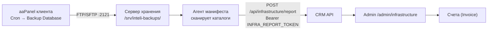

# Инфраструктура: резервное копирование и DR-кластеры

Сервис продаётся клиентам CRM: aaPanel на сервере клиента присылает дампы БД
по FTP/SFTP на наш сервер хранения, CRM ведёт услуги, проверяет копии и
выставляет счета.

## Компоненты



- **Сервер хранения**: `152.228.118.128`, `/srv/inteli-backups`. Один системный
  пользователь и один FTP-аккаунт на услугу, chroot в домашнем каталоге.
- **Транспорт**: vsftpd на порту `2121`, PASV `30000–30010`, без анонимного
  доступа. Для новых клиентов предпочтителен SFTP (aaPanel FTP Storage
  поддерживает FTP/SFTP); FTP допускается только с длинным паролем и
  ограничением по IP.
- **CRM**: услуги (`infrastructure_services`), цели (`backup_targets`),
  копии (`backup_runs`), кластеры (`dr_clusters`), счета через `invoices`.
- **Агент**: раз в 5–10 минут сканирует каталог, считает размеры и шлёт
  манифест в CRM. CRM не ходит на сервер хранения по SSH.

## Модель данных

| Таблица | Назначение |
|---|---|
| `infrastructure_services` | услуга: клиент, тип (`backup`/`cluster`), цена, статус, дата старта |
| `backup_targets` | FTP/SFTP-доступ, частота 1–7, retention, квота, последняя копия |
| `backup_runs` | файл копии: имя, размер, sha256, статус, время |
| `dr_clusters` | уровень (cold/warm/hot/active-active), размер, RTO/RPO, регион, runbook |
| `invoices` | `infrastructure_service_id` + `service_period` (уникальны вместе) |

## Тарифы

Резервное копирование (3 копии, сжатый объём `V` ГБ, частота `F` в неделю):

```
price = max(590, 390 + 60 × V) + 150 × (F − 1)
```

| Объём (3 копии) | 1× | 3× | 5× | 7× |
|---|---|---|---|---|
| до 3 ГБ | 590 | 890 | 1 190 | 1 490 |
| до 6 ГБ | 750 | 1 050 | 1 350 | 1 650 |
| до 15 ГБ | 1 290 | 1 590 | 1 890 | 2 190 |
| до 30 ГБ | 2 190 | 2 490 | 2 790 | 3 090 |
| до 75 ГБ | 4 890 | 5 190 | 5 490 | 5 790 |

Настройка — 1 500 ₽. DR-кластеры: cold 4 900/7 900/12 900, warm 14 900/24 900/39 900,
hot 34 900/59 900/94 900, active-active от 120 000 ₽/мес (S/M/L).
Настройка кластера — от 25 000 до 250 000 ₽.

## ADR

### ADR-001: Push-модель через FTP/SFTP, а не pull по SSH
**Контекст.** aaPanel уже умеет Backup Database → FTP Storage с retention.
**Решение.** Клиент присылает копии к нам; CRM не хранит SSH-доступы к клиентским
серверам. **Последствия.** Меньше привилегий у CRM, но состояние узнаём из
манифеста агента, а не напрямую из aaPanel.

### ADR-002: Манифест вместо прямого чтения хранилища CRM
**Контекст.** CRM в Docker без ssh/ftp-клиента; dev и prod в разных сетях.
**Решение.** Агент на сервере хранения POST-ит манифест на
`/api/infrastructure/report` с Bearer-токеном. **Последствия.** Простой firewall,
нет исходящих SSH из CRM; задержка статуса — интервал агента.

### ADR-003: Один сервис = одна цель
**Контекст.** У клиента может быть несколько БД.
**Решение.** Каждая БД — отдельная услуга и отдельный FTP-аккаунт.
**Последствия.** Прозрачные квоты и счета; больше записей в админке, но
проще аудит и удаление.

### ADR-004: Счёт за период, идемпотентно
**Контекст.** Ежемесячные списания и ручное выставление.
**Решение.** `invoices.infrastructure_service_id + service_period` уникальны;
`infrastructure:invoice` создаёт недостающие счета, ручная кнопка делает то же.
**Последствия.** Нет дублей; счёт можно выставить вручную до запуска cron.

## Настройка aaPanel у клиента

1. App Store → **FTP Storage**: host `152.228.118.128`, port `2121`, логин/пароль
   из карточки услуги, пассивный режим.
2. Cron → Add Task → **Backup Database**: выбрать БД, destination — FTP,
   cycle по тарифу, **Retained copies = 3**, backup reminder + канал.
3. Нажать Execute, проверить Log, затем «Проверить копии» в админке CRM.

## Агент

Скрипт лежит на сервере хранения (`/usr/local/bin/inteli-backup-agent`),
запускается cron каждые 10 минут. Конфиг: `/etc/inteli-backups/agent.json`:

```json
{
  "crm_url": "https://crm.inteli-dev.ru",
  "token": "INFRA_REPORT_TOKEN",
  "root": "/srv/inteli-backups",
  "targets": { "<service_uuid>": "crm" }
}
```

Манифест: `POST /api/infrastructure/report` c `Authorization: Bearer <token>`.
Ответ: `{data:{targets,runs,received_at}}`.

## Эксплуатация

- Проверка копий: кнопка «Проверить копии» (локальный манифест) или ожидание агента.
- Счета: `php artisan infrastructure:invoice` по расписанию (1-е число).
- Восстановление: скачать `*.sql.gz` с сервера хранения, `gunzip | psql`,
  для SQLite — распаковать и `PRAGMA integrity_check`.
- Ротация: aaPanel удаляет старые копии по retained copies; CRM хранит метаданные.
- Инцидент: если копий нет 48 ч — карточка «Без копий 48 ч» и алерт.
